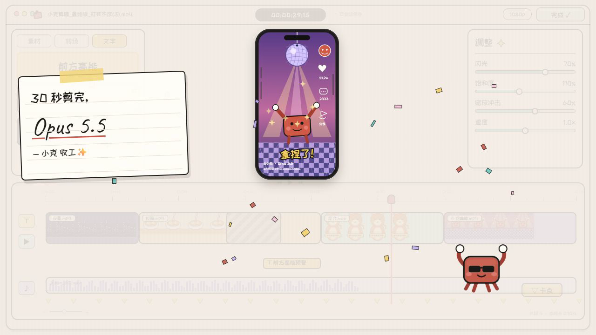

# 小克剪辑 · Editor Motion Replica

A 30-second Remotion recreation of a hand-drawn “AI video editor” screen recording: a tiny crab named 小克 builds an editor, drags clips, maxes the saturation slider, hits **BONK!**, and finishes with a sticky note that says **“30 秒剪完, Opus 5.5”**.

Everything visible is drawn with SVG, CSS and React. No frames, screenshots or video assets from the reference are used. The soundtrack is synthesized in code.

**Render:** 1280 × 720 · 30 fps · 30.000 s · 900 frames



---

## What is recreated

The reference is a 30 s, 1280×720, 30 fps screen recording of a playful, hand-drawn editing app. The recreation keeps the same *shot grammar* and UI structure:

- centered beige/paper editor window with a black hand-drawn border;
- traffic lights, filename, timecode, 1080p pill and teal export button;
- left asset/transition/text panel, phone preview, right adjustment sliders, bottom timeline;
- red crab mascot with white gloves, speech bubbles, long pointing arms and sunglasses;
- yellow/pink/teal stickers, stamped “已提交 / 已修正”, Ctrl+Z keycap, **BONK!**;
- phone previews for night city, ramen, cat, and a disco crab;
- end card with a lined sticky note, social overlay and confetti.

The result is an **interpretive, code-drawn recreation**, not a pixel-for-pixel clone. Text, timing, composition and motion beats follow the reference.

## Beat / shot sheet

| Time | Beat |
|---|---|
| 0.0–1.5 | Terminal window: `const 剪辑软件 = 小克.写代码()`, line 2 draws the editor, line 3 `小克.钻` |
| 1.5–2.2 | Terminal scales away; editor UI assembles |
| 2.3 | Crab arrives with “开工！” |
| 2.3–4.6 | Night-city preview; assets and timeline clips build |
| 6.0–8.0 | Phone defocuses (“对焦中..”), ramen scene, sleepy crab |
| 8.0–10.0 | Trash can, “拜拜~”, “哐当！”; transition panel |
| 10.0–12.0 | Cat scene, “空心入网！”, 已提交 stamp |
| 13.2–15.2 | 撤销！ + Ctrl+Z keycap + 已修正 stamp |
| 15.9–18.5 | Camera punch-in, saturation glitch, “饱和度:拉满”, “……太亮了” |
| 18.9–21.5 | Sliders settle (flash 70 / saturation 110 / impact 60), “稳了” |
| 21.5–23.9 | “卡点！” text, yellow beat markers, timeline button |
| 23.9–25.5 | Export → 渲染中 99% → 完成 ✓ |
| 25.5–26.2 | **BONK!**; chrome fades |
| 26.2–30.0 | Sticky note: “30 秒剪完, Opus 5.5 — 小克 收工✨” + end-card phone |

## Design system

- **Paper:** `#f2ece4` / `#fbf7f0`
- **Ink:** `#1b1a17`
- **Teal:** `#68c6be` / `#2c9a91`
- **Yellow:** `#f4d268`
- **Pink:** `#f6c7d8` / `#e98aa8`
- **Lavender disco:** `#c1b2f4`
- **Crab red:** `#c45b4b`
- **Stamp green:** `#7fbe8d`

Fonts (all bundled, subsets):

- `ZCOOL KuaiLe` — hand-drawn Chinese UI and stickers (OFL)
- `Caveat` — sticky-note Latin handwriting (OFL)
- `Luckiest Guy` — BONK! (Apache-2.0)

The phone previews, crab, timeline, panels and stickers are all local React/SVG components under `src/components`.

## Audio

`public/audio/soundtrack.wav` is generated by `scripts/make_audio.py` using numpy only:

- 92 BPM lo-fi bed: synthesized kick/snare/hats, Rhodes-like chords, bass, vinyl crackle;
- typing clicks, UI pops, whooshes, stamps, glitch/riser, BONK, closing bells;
- mixed for the 30 s cut, no downloaded samples.

The edit is intentionally picture-first; audio supports the cuts rather than driving them.

## Run

```bash
npm install
npm run studio
```

Render the film:

```bash
npm run render
# or
npx remotion render src/index.ts EditorMotion out/editor-motion.mp4 \
  --codec=h264 --crf=18 --pixel-format=yuv420p \
  --audio-codec=aac --audio-bitrate=256k
```

If Remotion cannot find a browser, pass the local Chrome executable:

```bash
npx remotion render src/index.ts EditorMotion out/editor-motion.mp4 \
  --browser-executable="C:\Program Files\Google\Chrome\Application\chrome.exe"
```

Regenerate the audio (optional, headless):

```bash
python scripts/make_audio.py
```

Regenerate the font subsets (optional):

```bash
python scripts/get_fonts.py
```

## Project structure

```
public/
  audio/soundtrack.wav        # code-generated 30 s cue
  fonts/                      # bundled subsets + licenses
src/
  Root.tsx                    # composition: 1280×720, 30 fps, 900 frames
  Video.tsx                   # audio + font loading
  theme.ts                    # palette, font faces
  timing.ts                   # time constants, spring helpers
  components/
    EditorUI.tsx              # shell, crab, stickers, end card, terminal
    Phone.tsx                 # phone frame + night/ramen/cat/disco scenes
    AssetPanel.tsx            # assets / transitions / text tabs
    Inspector.tsx             # sliders + values
    Timeline.tsx              # ruler, clips, waveform, markers, playhead
    Crab.tsx                  # mascot + long arm
    Stickers.tsx              # speech bubbles, stickers, keycap, sticky note
scripts/
  make_audio.py               # code-synthesized score and SFX
  get_fonts.py                # Google Fonts subset downloader
```

## Font licenses

- `public/fonts/OFL-ZCOOL-KuaiLe.txt`
- `public/fonts/OFL-Caveat.txt`
- `public/fonts/LICENSE-Luckiest-Guy.txt` (Apache 2.0)

## Notes

- The reference video is **not** included in this repository, and no reference frames are used in the render.
- The recreation is a stylistic study: original drawings, original timing implementation, original synthesized audio.
- “Opus 5.5”, “小克”, the crab and the UI copy are reproduced as part of the visual homage.
